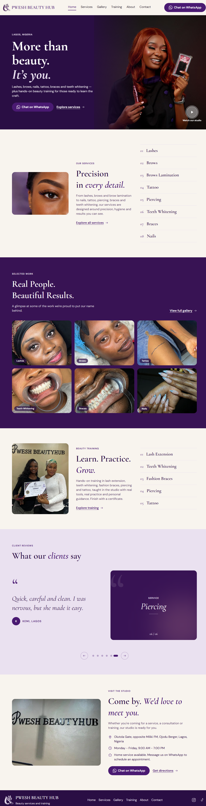

# PWESH BEAUTY HUB

A responsive, multi-page website built for **PWESH BEAUTY HUB**, a beauty studio and training centre in Ojodu Berger, Lagos, Nigeria.

The website showcases the studio's services, portfolio, training programmes, and business information. It also makes it easy for potential customers to enquire about services and bookings directly through WhatsApp.

**Live Website:** https://pwesh-beauty-hub.netlify.app

## Application Preview



## About the Project

This is a real-world website developed for an operating beauty business.

The goal was to create a professional, mobile-friendly online presence where visitors can explore the studio's services, view examples of its work, learn about available training programmes, and make enquiries without unnecessary steps.

## Technologies Used

- React 19
- TypeScript
- Tailwind CSS 4
- React Router 7
- Vite 8

## Pages

- **Home:** Introduces the studio, highlights services and selected work, and features training programmes and testimonials.
- **Services:** Displays available beauty services with category filters and direct booking enquiry options.
- **Gallery:** Showcases completed work with category filters and an interactive photo slider.
- **Training:** Presents the studio's training courses, practical sessions, and certificates.
- **About:** Introduces the business and its owner.
- **Contact:** Provides location details, directions, opening hours, and social media links.
- **404:** Provides a custom page for unavailable routes.

## Key Features

- WhatsApp enquiry links with pre-filled messages for individual services.
- Sticky WhatsApp contact bar on mobile devices.
- Interactive gallery with next/previous navigation and keyboard controls.
- Gallery modal with Escape-key and outside-click dismissal.
- Auto-playing testimonial slider with touch support and reduced-motion consideration.
- Video popup featuring a YouTube Short.
- Responsive navigation with a mobile hamburger menu.
- Centralised configuration for WhatsApp details, social links, video, and testimonials.
- Page-specific titles and meta descriptions for search engines and link sharing.
- Custom favicon and robots.txt.

## Performance and Accessibility

Mobile Lighthouse results recorded during development:

| Category       | Score |
| -------------- | ----: |
| Performance    |    91 |
| Accessibility  |   100 |
| Best Practices |   100 |
| SEO            |   100 |

### Optimisation and Quality Improvements

- Converted and compressed images to WebP to reduce image file sizes.
- Preloaded the hero image with high priority to improve loading performance.
- Improved accessibility with a main landmark and larger slider control touch targets.
- Added a valid robots.txt file for search engine crawling.
- Implemented reduced-motion support.

_Lighthouse scores are recorded test results and may vary depending on testing conditions._

## Project Structure

```text
src/
├── assets/       # Images, logos, and visual assets
├── components/   # Reusable UI components
├── config/       # Business details and content configuration
└── pages/        # Application pages

public/           # Public assets, favicon, and robots.txt
screenshots/      # README application screenshots
```

## Getting Started

To run the project locally:

1. Clone the repository:

   ```bash
   git clone https://github.com/Damilola-Dev1/pwesh-beauty-hub.git
   ```

2. Navigate into the project directory:

   ```bash
   cd pwesh-beauty-hub
   ```

3. Install dependencies:

   ```bash
   npm install
   ```

4. Start the development server:

   ```bash
   npm run dev
   ```

### Production Build

To create an optimised production build:

```bash
npm run build
```

To preview the production build locally:

```bash
npm run preview
```

## Deployment

The website is deployed on Netlify.

**Live Website:** https://pwesh-beauty-hub.netlify.app

## Developer

**Damilola Samuel A.**

Frontend Developer | Lagos, Nigeria

- [GitHub](https://github.com/Damilola-Dev1)
- [LinkedIn](https://www.linkedin.com/in/damilola-samuel-a-a3bb6b360/)

_This project was developed for Pwesh Beauty Hub. Studio photographs were used with permission._
